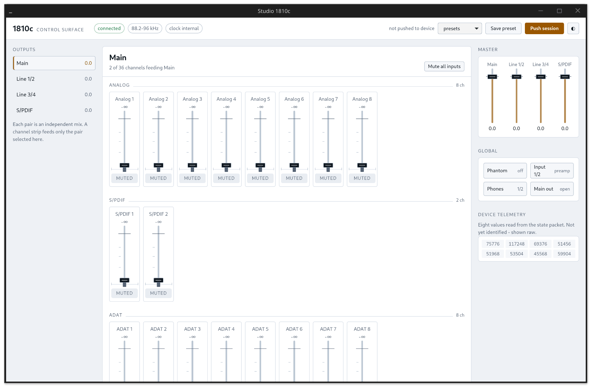

# Studio 1810c for Linux

**The mixer PreSonus never shipped for Linux — matrix, faders, switches, all of it.**



The Studio 1810c is an 18-in / 8-out USB audio interface. On Windows and macOS,
Universal Control gives you an 18×10 routing matrix, output faders, front-panel
switch control and clock status. On Linux, `snd-usb-audio` streams the audio
beautifully and exposes **five** switches. Everything else — the part that makes
the interface worth owning — was a black box.

This project opens it. It speaks the vendor USB protocol directly, the same one
the macOS driver uses, and gives the mixer back as a native desktop application.
Audio keeps streaming through the kernel driver the whole time: every control
transfer goes over EP0 to the vendor interface, so nothing is unbound, no module
is patched, and playback is never interrupted.

## What you get

- **36 channel strips** — Analog 1–8, S/PDIF, ADAT 1–8, DAW 1–18 — each with
  level, pan and mute, feeding four output pairs.
- **Output faders** for Main, Line 1/2, Line 3/4 and S/PDIF.
- **Front-panel switches** from the desktop: 48 V, line/instrument, mute, mono, A/B.
- **Clock and rate readout** in the header, read from the device.
- **Presets** — a routed setup saved once and recalled in a click.
- **A real application**: window, menu entry, icon. No browser tab, no address
  bar, no terminal, no `pip install`.
- **A CLI** (`uc1810c.py`) for scripting, and the complete protocol documentation
  so other interfaces in the family can be added.

## Status

| piece | state |
|---|---|
| matrix routing (`mix`), output faders (`out`), front-panel switches (`switch`) | **verified on hardware** — `./uc1810c.py verify` round-trips a write and the kernel's own ALSA control confirms it; 62 byte-exact unit tests |
| state packet read (`state`) | **verified live**; fields 58-62 = switches, 4-11 = eight fluctuating values, 46/47 = 0x100, rest 0 |
| clock readout (`clock`, 0xA4) | **answers on hardware, but only to interface 3**; returns an all-zero status word for all three sources, meaning unresolved |
| DSP blob read (`blob`, 0xD1/0xD2) | device **stalls** every shape tried — see "requests the device refuses" in `PROTOCOL.md` |
| bulk command channel | documented, not implemented; the only bulk pair is the MIDI interface |

Nothing here writes flash or changes firmware. `reset-routing` only rewrites the
mixer matrix, exactly as the kernel already does at probe time.

## Install

### Ubuntu, Debian, Linux Mint (the normal way)

Download `studio-1810c_1.0.0_amd64.deb` from [Releases](../../releases), then:

```bash
sudo apt install ./studio-1810c_1.0.0_amd64.deb
```

or double-click the file and let your software installer handle it. `apt` pulls
in the three libraries it needs (GTK 3, WebKitGTK, python3-gi).

That is the whole installation. The package adds the menu entry, the icon, a man
page **and the udev rule that grants access to the interface** — no permission
step, no group to join, no reboot.

Open **Studio 1810c** from the application menu and plug the interface in. If you
launch the app before plugging the interface in, it picks it up within a few
seconds.

`bash install.sh` does the same thing if you prefer one command in a terminal.

### Other distributions

No prebuilt package, but building takes a minute: see
[docs/BUILDING.md](docs/BUILDING.md) for Fedora, Arch, openSUSE and anything else
with GTK 3 + WebKitGTK, including an RPM spec and a PKGBUILD.

### From a checkout (developers)

```bash
python3 -m venv .venv && ./.venv/bin/pip install pyusb
sudo install -m644 99-presonus-1810c.rules /etc/udev/rules.d/
sudo udevadm control --reload && sudo udevadm trigger
./ucapp.py                          # the desktop application
./uc1810c-gui                        # or: daemon + browser, if you prefer a tab
```

## First run

The window opens with your saved session. Nothing is sent to the interface until
you change something, and the header says **not pushed to device** until the
first write of the session — the matrix cannot be read back, so claiming
otherwise would be a lie.

Move a fader and that strip is sent as you make it. After loading a preset, press
**Push session** to send the whole thing.

Full walkthrough: [docs/MANUAL.md](docs/MANUAL.md).

## Command line

The same protocol layer, scriptable:

```bash
./uc1810c.py doctor                 # USB, ALSA, module param, usbfs permission
./uc1810c.py state                  # 63-field state packet (58-62 = switches)
./uc1810c.py mix daw1 main LR -6    # DAW 1 -> Main, both sides, -6 dB
./uc1810c.py mix analog3 1/2 L -20  # Analog 3 -> Line 1/2 left, -20 dB
./uc1810c.py out spdif R -inf       # mute S/PDIF right  (use -100)
./uc1810c.py switch 48v on
./uc1810c.py reset-routing          # kernel-equivalent direct routing
./uc1810c.py clock 2                # ADAT clock lock status (0=A4 request)
./uc1810c.py blob --length 256 --out dsp.bin
./uc1810c.py verify                 # write/read round-trip against the hardware
```

`--dry-run` prints the exact control transfers without sending them; `-v` prints
them for real traffic too.

Channel numbering (from the kernel driver's usbmon captures):

```
inputs   0-7   analog 1-8      8-9   S/PDIF     10-17 ADAT 1-8     18-35 DAW 1-18
pairs    0 Main   1 Line 1/2   2 Line 3/4   3 S/PDIF   4-8 (1824c ADAT)
gains    0 = -inf        0x1000000 = 0 dB       2**24 * 10**(dB/20)
```

## How it works

`uc1810c.py` opens the interface with libusb and sends vendor control transfers
(bmRequestType `0x40`, bRequest `0xA0`, a 28-byte packet) to the mixer on the
App-Specific interface. State is read back with a 252-byte `0xA1`/`0xA2` pair.
None of this touches the streaming interfaces, so the kernel driver keeps running
and audio never stops.

The protocol was recovered by static analysis of the macOS Universal Control
5.1.1 binaries and confirmed against the hardware. Everything learned — request
numbers, packet layout, field offsets, and the traps that cost hours — is in
[PROTOCOL.md](PROTOCOL.md); the narrative and method are in [REPORT.md](REPORT.md).

Traps worth knowing before you write your own client:

- the state packet's first 32-bit field must stay **zero**; put a sequence number
  there and the device stalls the endpoint with EPIPE;
- `0xA4` (clock status) only answers when addressed to interface 3, and stalls
  for every other recipient;
- the matrix is write-only. There is no read-back, which is why the UI tracks a
  "pushed" state explicitly instead of pretending it knows.

## Sample rate is not ours

The 1810c encodes the sample rate in the streaming altsetting, so ALSA picks it
when a client opens the device. The kernel's `s1810c_skip_setting_quirk`
(`quirks.c`, USB `194f:010c`) keeps only the altsets matching
`snd_usb_audio.device_setup`: at 96 kHz the box runs 8 out / 14 in, at 192 kHz
6 out / 8 in. Set that module option, not this tool.

## What is not finished

Being straight about this, because you will notice:

- **Meters are not available from this firmware** — not "not decoded yet",
  tested. In order: interface 5 (the vendor interface) has **zero endpoints** and
  the only interrupt IN on the device is `0x83`, the 6-byte UAC2 status pipe on
  interface 0, so there is no meter stream to read; the eight raw values in the
  state packet follow neither playback (a −20 dBFS tone to S/PDIF moves them by
  less than their own drift) nor a mic on input 1 (tapping and sweeping its gain
  left them flat); and the DSP parameter channel that carries Universal Control's
  own meter parameter names (`input1LevelMeter`, `input1ReductionMeter`, …)
  answers on no recipient or interface index. The macOS driver contains no
  metering code either — only volume and line-level controls. The conclusion is
  that the 1810c does not report levels to the host. Honest metering on Linux has
  to be computed from the audio stream (PipeWire peak monitoring), which is the
  planned approach; the eight unknown values are shown raw and labelled as such
  until they are identified.
- **Clock status semantics are unresolved.** `0xA4` answers, but returns an
  all-zero status word for internal, S/PDIF and ADAT alike — the encoding is
  unknown, so the UI reports only what it can prove.
- **Only the 1810c is tested.** The 1824 and 1824c share the protocol family (same
  vendor ID, adjacent PIDs) and should work, but nobody has verified them.
- **No DSP effects control.** The DSP parameter block was located in the binary,
  but the interface stalls every read shape tried.

## Compatibility

| | |
|---|---|
| Interface | PreSonus / Fender Studio 1810c (`194f:010c`) |
| Also expected to work | Studio 1824 (`194f:0107`), 1824c (`194f:010d`) — untested |
| Distributions | Any with GTK 3 + WebKitGTK and Python 3.8+; `.deb` built for Ubuntu 22.04+ |
| Kernel | Stock `snd-usb-audio`; no patching, no modules unloaded |
| Desktop | GNOME, KDE, Xfce — Wayland and X11 |

## Documentation

| File | What is in it |
|---|---|
| [docs/MANUAL.md](docs/MANUAL.md) | User manual: every control, presets, troubleshooting |
| [docs/BUILDING.md](docs/BUILDING.md) | Build on any distribution; RPM spec and PKGBUILD |
| [PROTOCOL.md](PROTOCOL.md) | The vendor USB protocol, byte by byte, with evidence |
| [REPORT.md](REPORT.md) | How it was reverse-engineered |
| [ghidra_scripts/](ghidra_scripts/) | The scripts used to extract the protocol from the binary |

## Project layout

```
uc1810c.py          protocol client + CLI (libusb, stdlib only)
ucd.py              control-surface state and HTTP/JSON layer
ucapp.py            desktop window (GTK3 + WebKit2)
ui/                 the control surface itself (HTML/CSS/JS)
uc1810c-gui         launcher for the daemon + browser mode
install-desktop.sh  adds the app menu entry for a checkout
vendor/             vendored pyusb, so nothing needs pip at runtime
tests/              byte-exact protocol tests (no hardware needed)
tools/              hardware probes used to characterise the device
packaging/          .deb build script, desktop entry, icon, man page, RPM spec, PKGBUILD
ghidra_scripts/     Ghidra scripts that dumped the protocol out of the mach-o binary
```

## Tests

```bash
./.venv/bin/python tests/test_protocol.py     # 62 checks, no hardware required
./uc1810c.py verify                           # write/read round-trip on real hardware
```

## Credit

The `0xA0`/`0xA1`/`0xA2` half of this protocol was reverse engineered by **Nick
Kossifidis** from usbmon captures and lives in `sound/usb/mixer_s1810c.c` in the
Linux kernel; that driver is what made the whole thing tractable. The `0xA4`,
`0x42` and `0xD0`–`0xD4` requests and the model table came out of the Universal
Control 5.1.1 macOS binaries — see [REPORT.md](REPORT.md).

## Legal

Not affiliated with, endorsed by, or supported by PreSonus or Fender. No vendor
code or firmware is redistributed here: the protocol was derived from observing
USB traffic and from static analysis of software you are entitled to run. Nothing
in this project writes flash, changes firmware, or permanently modifies the
device — `reset-routing` only rewrites the mixer matrix, exactly as the kernel
driver already does at probe time.

Interoperability work of this kind is protected in the EU (Software Directive
2009/24/EC, Art. 6) and is long-standing practice for hardware you own. Still:
this is community software, provided as is.

## Licence

MIT — see [LICENSE](LICENSE). The vendored `pyusb` is BSD-3-Clause and the
kernel reference copies are GPL-2.0-only; both are spelled out in [NOTICE](NOTICE).
