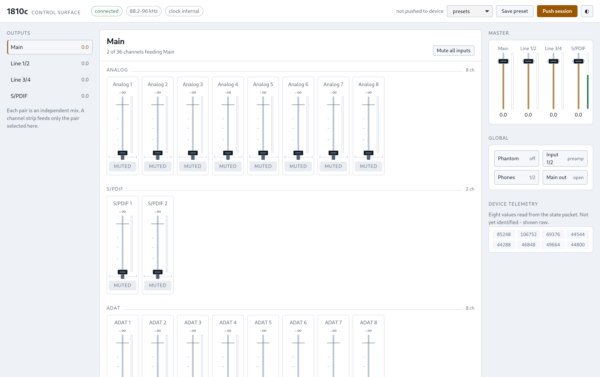

# Studio 1810c for Linux

**The mixer PreSonus never shipped for Linux — routing matrix, faders, switches,
clock, all of it.**



The Studio 1810c is an 18-in / 8-out USB audio interface. On Windows and macOS,
Universal Control gives you an 18×10 routing matrix, output faders, front-panel
switch control and clock status. On Linux, `snd-usb-audio` streams the audio
beautifully and exposes **five** switches — and nothing else.

This is that missing control surface, as a native desktop application.

## Install

**Ubuntu, Debian, Linux Mint** — download
[`studio-1810c_1.1.2_amd64.deb`](https://github.com/xenprotocol/studio-1810c/releases/latest)
and install it:

```
sudo apt install ./studio-1810c_1.1.2_amd64.deb
```

**Fedora** — grab the `.rpm` from the same page:

```
sudo dnf install ./studio-1810c-1.1.2-1.fc40.noarch.rpm
```

**Arch** — the `PKGBUILD` is in `packaging/`:

```
cd packaging && makepkg -si
```

## What it does

- 36 channel strips: Analog 1–8, S/PDIF, ADAT 1–8, DAW 1–18 — level, pan, mute
- Output faders for Main, Line 1/2, Line 3/4 and S/PDIF
- Front-panel switches from the desktop: 48 V, line/instrument, mute, mono, A/B
- Clock source and sample rate read from the device
- Live level meters, and presets you can recall in a click
- **Reset routing** puts the default wiring back without a terminal

## The honest limits

- **Meters are computed from the audio stream, not read from the interface.** The
  firmware does not report levels, which was established four different ways. Bars
  follow PipeWire or PulseAudio, so they need one of those running.
- **The Studio 1824 and 1824c are refused by name.** Their matrix is a different
  size; nothing is written to them.
- **No kernel patches, no firmware writes.** Control transfers go over EP0 to the
  vendor interface while `snd-usb-audio` keeps streaming.

## Is this my interface?

The Studio 1810c enumerates as `194f:010c`. Check with `lsusb` — if that ID is
there, this software is for your hardware.

## Searching for a Linux driver?

There is no vendor driver, and none is needed for audio: the interface is
class-compliant and already works with ALSA. What was missing is everything that
is not audio — the mixer. That is what this project restores, in the same layout
Universal Control uses on macOS and Windows.

## Links

- [Source and releases](https://github.com/xenprotocol/studio-1810c)
- [The manual](MANUAL.md) — every control, and what it does
- [The protocol](https://github.com/xenprotocol/studio-1810c/blob/main/PROTOCOL.md) — the
  reverse engineering, for anyone porting this to the 1824 or another model
- [Building and packaging](BUILDING.md) — for other distributions

Made on Linux, for people who use Linux to make music.
